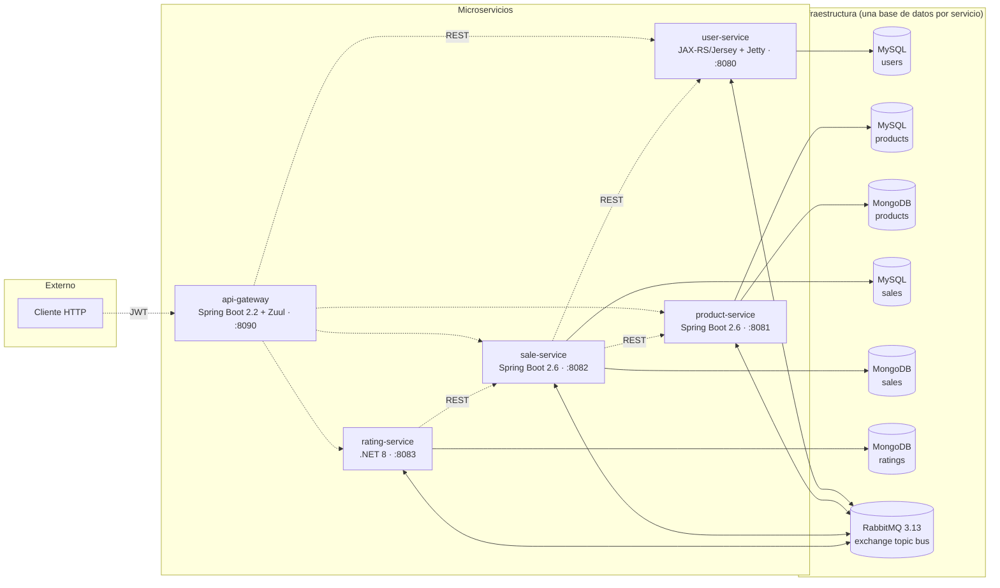
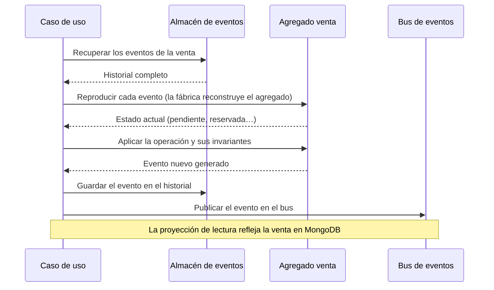
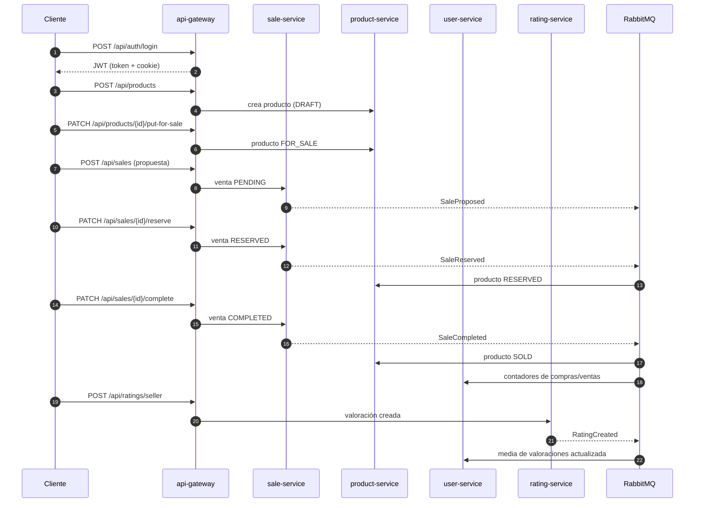

# Backend: plataformas, frameworks y arquitectura

Este documento describe sobre qué plataformas y con qué frameworks está construido el backend de SegundUM, los estilos de arquitectura aplicados, cómo se comunican los servicios, cómo se integra la API Gateway y cómo funcionan la documentación OpenAPI y la autenticación JWT. La visión de los datos (entidades, esquema y almacenes) está en [`02-datos.md`](02-datos.md).

## Plataformas y frameworks

SegundUM es un backend **políglota**: la mayoría de servicios están en Java, y la valoración en .NET, demostrando que los microservicios pueden mezclar plataformas y comunicarse igualmente por REST y el bus de eventos.

| Servicio | Plataforma | Framework / tecnología | Puerto |
| --- | --- | --- | --- |
| `api-gateway` | Java 11 | Spring Boot 2.2 + Netflix Zuul | 8090 |
| `user-service` | Java 11 | JAX-RS (Jersey 2.41) sobre Jetty (WAR) | 8080 |
| `product-service` | Java 11 | Spring Boot 2.6 | 8081 |
| `sale-service` | Java 11 | Spring Boot 2.6 | 8082 |
| `rating-service` | .NET 8 | Minimal APIs | 8083 |

Tecnologías transversales:

- **Persistencia:** MySQL 8 y MongoDB 8.
- **Mensajería:** RabbitMQ 3.13.
- **Seguridad:** JWT (HS256) y hash de contraseñas con BCrypt.
- **Clientes HTTP internos:** Retrofit (Java) y Refit (.NET).
- **Documentación de la API:** OpenAPI con Swagger UI.
- **Despliegue:** Docker Compose (build desde código fuente).

## Microservicios

El sistema está descompuesto en cinco servicios desplegados con Docker Compose, cada uno con su propia base de datos (*base de datos por servicio*). El **API Gateway** es la única puerta de entrada: todo el tráfico externo pasa por él.

> [!NOTE]
> Cada servicio usa su propia base de datos: ningún servicio accede directamente a las bases de datos de otro; la información compartida llega por el bus de eventos o mediante llamadas REST. Por simplicidad del despliegue con Docker Compose, todas las bases de datos lógicas de MySQL se alojan en un único contenedor MySQL y, del mismo modo, las de MongoDB en un único contenedor MongoDB.

| Servicio | Responsabilidad |
| --- | --- |
| `api-gateway` | Enrutado de las peticiones, emisión y borrado del JWT (login/logout) y autorización |
| `user-service` | Registro, autenticación, perfiles, roles (`USER` / `ADMINISTRATOR`), estadísticas y valoraciones recibidas |
| `product-service` | Catálogo: categorías (cargadas desde XML en el arranque), productos con su ciclo de vida, búsqueda paginada, vistas, histórico mensual y réplica de vendedores |
| `sale-service` | Ciclo de vida de las ventas (máquina de estados) y consulta de las partes implicadas |
| `rating-service` | Valoraciones entre las partes de una venta completada |

## Estilos de arquitectura

SegundUM aplica varios estilos de arquitectura, cada uno en los servicios donde aporta:

| Estilo | `user-service` | `product-service` | `sale-service` | `rating-service` | `api-gateway` |
| --- | :-: | :-: | :-: | :-: | :-: |
| Arquitectura limpia | ✅ | ✅ | ✅ | ❌ | ❌ |
| Arquitectura hexagonal | ✅ | ✅ | ✅ | ✅ | ❌ |
| Domain-Driven Design | ✅ | ✅ | ✅ | ❌ | ❌ |
| CQRS | ❌ | ✅ | ✅ | ❌ | ❌ |
| Event sourcing | ❌ | ❌ | ✅ | ❌ | ❌ |

### Arquitectura limpia

La arquitectura limpia organiza el código en capas concéntricas: las reglas de negocio viven en el interior y las decisiones técnicas (frameworks, bases de datos, transporte) en el exterior, de modo que **el interior nunca depende del exterior, sino al revés**.

**Aplicado en:** `user-service`, `product-service` y `sale-service`.

Los tres servicios Java se organizan en tres capas:

- **Dominio**: los modelos y las reglas de negocio (usuarios, productos, categorías, ventas) junto con sus validaciones y sus excepciones propias. Esta capa no utiliza ningún framework: depende solo de la biblioteca estándar del lenguaje.
- **Casos de uso**: la orquestación de cada operación del sistema (registrar un usuario, publicar un producto, completar una venta…), escrita de forma independiente de cualquier tecnología concreta.
- **Infraestructura**: los detalles técnicos (API REST, acceso a bases de datos, mensajería, seguridad) que se conectan con las capas interiores a través de interfaces.

Toda la configuración y el ensamblaje de las piezas se concentra en un único punto de composición por servicio, de forma que sustituir un componente técnico (el motor de persistencia, el cliente del bus…) no obliga a tocar las capas de negocio.

### Arquitectura hexagonal

La arquitectura hexagonal (puertos y adaptadores) define el núcleo de la aplicación mediante interfaces llamadas **puertos**: los de **entrada**, por los que llegan las peticiones, y los de **salida**, por los que el núcleo toca el exterior (persistencia, mensajería, otros servicios). Los **adaptadores** son las implementaciones concretas de cada puerto; viven en el borde y contienen la tecnología, de modo que se puede cambiar de tecnología sin tocar el núcleo.

**Aplicado en:** `user-service`, `product-service`, `sale-service` y `rating-service`.

Puertos de salida y sus adaptadores:

| Necesidad del núcleo (puerto) | Adaptador | Tecnología | Servicios |
| --- | --- | --- | --- |
| Guardar los datos transaccionales | Repositorio sobre JPA | MySQL | `user`, `product`, `sale` |
| Consultar los modelos de lectura | Repositorios de consulta | MySQL en `user`; MongoDB en `product` y `sale` | `user`, `product`, `sale` |
| Publicar los eventos de dominio | Adaptador del bus de eventos | RabbitMQ | `user`, `product`, `sale`, `rating` |
| Consultar a otros servicios | Cliente HTTP interno | REST (Retrofit en Java, Refit en .NET) | `sale`, `rating` |
| Validar contraseñas | Hash con sal | BCrypt | `user` |
| Cargar la jerarquía de categorías | Lector de árboles XML | XML | `product` |
| Almacenar y recuperar los eventos de las ventas | Almacén de eventos | MySQL | `sale` |

Puertos de entrada y sus adaptadores:

| Puerto de entrada | Adaptador | Tecnología | Servicios |
| --- | --- | --- | --- |
| Recibir peticiones HTTP | Controlador REST (puntos de entrada HTTP en .NET) | JAX-RS (Jersey), Spring MVC, .NET Minimal APIs | `user`, `product`, `sale`, `rating` |
| Recibir eventos del bus | Consumidor de colas | RabbitMQ | `user`, `product` |
| Ejecutar los casos de uso para verificarlos | La propia prueba unitaria (el test ocupa el lugar del controlador) | JUnit 5, xUnit | `user`, `product`, `sale`, `rating` |

Los adaptadores de entrada traducen lo que llega del exterior (una petición HTTP, un evento del bus, la invocación de un test) a objetos de entrada y delegan siempre en los casos de uso, sin contener lógica de negocio. Los consumidores del bus son la **puerta de entrada asíncrona**: por ejemplo, un evento de venta reservada pone en marcha un caso de uso que actualiza el estado del producto, y los eventos de ventas y valoraciones incrementan los contadores del usuario.

Un caso particular es `rating-service`: además de los puertos anteriores, define uno para leer las partes de una venta en el servicio de ventas, cuyo adaptador traduce los errores del transporte (por ejemplo, un «no encontrado») a resultados nulos, para que la tecnología no se filtre hacia dentro.

Los tests son, a su vez, adaptadores de entrada: llaman a los casos de uso a través de su puerto (el mismo que usa la API REST)sin pasar por HTTP. A la salida, en lugar de tocar bases de datos o el bus real, inyectan dobles en memoria (*fakes*) para el repositorio, las consultas, la publicación de eventos y las llamadas a otros servicios, de modo que los casos de uso se prueban aislados de la infraestructura (más detalle en [`03-pruebas.md`](03-pruebas.md)).

### Domain-Driven Design

El enfoque DDD modela el dominio con un lenguaje cercano al negocio y lo aborda en dos frentes: el **diseño estratégico**, que delimita dónde vive cada modelo, y el **diseño táctico**, que enriquece cada modelo por dentro.

#### Diseño estratégico

**Límites acotados.** El sistema se divide en cuatro contextos, cada uno en su microservicio y dueño exclusivo de su modelo y de sus datos:

| Contexto | Microservicio | Modelo que posee | Frontera |
| --- | --- | --- | --- |
| **Usuarios** | `user-service` | Credenciales, perfiles, roles, estados y estadísticas | No conoce productos ni ventas |
| **Productos** | `product-service` | Productos, categorías, vendedores y puntos de recogida | No tiene usuarios: solo la réplica del vendedor; no tiene ventas |
| **Ventas** | `sale-service` | Las ventas entre comprador y vendedor y su ciclo de vida | No tiene usuarios ni productos: congela los datos que necesita (título, precio, nombre del vendedor) |
| **Valoraciones** | `rating-service` | Las valoraciones entre las partes de una venta completada | No tiene ventas: solo su identificador y sus partes |

Ningún contexto consulta los datos de otro (cada uno tiene su propia base de datos, ver [`02-datos.md`](02-datos.md)); lo que hace falta del contexto upstream no se referencia, se **copia al modelo propio**, de modo que un contexto nunca depende de la disponibilidad de otro en tiempo de ejecución.

**Lenguaje ubicuo.** Cada contexto habla su propio idioma, y los términos del negocio coinciden con los del código, la API y los estados del sistema. Cada glosario recoge primero las acciones que el contexto permite y después los términos que nombra; algunos términos se repiten entre contextos con un significado distinto (*vendedor, comprador, venta, producto*) y en cada tabla aparecen con el sentido de ese contexto.

**Contexto Usuarios**

| Término | Significado |
| --- | --- |
| *registrarse* | Darse de alta con correo, contraseña y datos personales |
| *autenticarse* | Validar correo y contraseña para usar el sistema |
| *desactivarse* | La cuenta pasa a inactiva y deja de poder usarse |
| **vendedor** | El rol con el que se acumulan sus estadísticas de ventas |
| **comprador** | El rol con el que se acumulan sus estadísticas de compras |

**Contexto Productos**

| Término | Significado |
| --- | --- |
| *publicar* | Poner un borrador a la venta (`FOR_SALE`) |
| *retirar* | Quitar de la venta un producto publicado; vuelve a borrador |
| *descartar* | Desechar un borrador que no se va a publicar (`DELETED`) |
| *eliminar* | Retirar definitivamente un producto en venta (`DELETED`) |
| **borrador** | Producto creado que aún no está a la venta (`DRAFT`) |
| **vendedor** | Réplica del usuario que publica productos en el catálogo |
| **venta** | El estado de comercialización del propio producto (`DRAFT`, `FOR_SALE`…) |
| **producto** | La entidad completa (título, precio, categoría, vendedor, punto de recogida) |

**Contexto Ventas**

| Término | Significado |
| --- | --- |
| *proponer una venta* | El comprador propone que el vendedor le venda su producto; la venta queda pendiente (`PENDING`) |
| *reservar* | El vendedor acepta la propuesta (`RESERVED`) |
| *rechazar* | El vendedor no acepta la propuesta (`REJECTED`) |
| *completar* | La venta se cierra tras la entrega (`COMPLETED`) |
| *cancelar* | Cualquiera de las partes da por terminada una venta reservada |
| **venta** | El acuerdo entre comprador y vendedor y su ciclo de vida |
| **comprador** | La parte que adquiere el producto |
| **vendedor** | La parte que vende de esa venta concreta (sus datos quedan congelados en la venta) |
| **producto** | Solo su identificador y los datos que la venta congela |

**Contexto Valoraciones**

| Término | Significado |
| --- | --- |
| *valorar al vendedor* | Puntuar al vendedor de una venta completada |
| *valorar al comprador* | Puntuar al comprador de una venta completada |

#### Diseño táctico

La capa de dominio aplica el arsenal táctico del DDD: **value objects** con validación propia, **entidades y agregados** con invariantes, **fábricas** que garantizan objetos válidos, **eventos de dominio** y **excepciones de dominio** expresivas.

**Aplicado en:** `user-service`, `product-service` y `sale-service`.

- **`user-service`** (contexto Usuarios): los value objects (correo, nombre, apellidos, contraseña, teléfono y fechas) se autovalidan al crearse: un correo sin formato válido o una contraseña demasiado corta no pueden llegar a existir. El usuario es una entidad con su rol (`USER` / `ADMINISTRATOR`) y su estado (activo o inactivo), con comprobaciones internas para que ninguna operación se aplique a un usuario desactivado; la fábrica de usuarios es la única vía de creación, tanto en el registro como en la reconstrucción. Cada cambio relevante genera su evento de dominio (registro, actualización y desactivación), y los errores de negocio se expresan con excepciones de dominio autoexplicativas («la contraseña es demasiado corta», «el correo ya está registrado»).
- **`product-service`** (contexto Productos): value objects para precio, título, descripción, identificadores y fechas; entidades producto, categoría, vendedor y punto de recogida, cada una con su fábrica. El producto tiene su máquina de estados (borrador, en venta, reservado, vendido, eliminado) protegida por invariantes que impiden transiciones ilegales (solo se puede publicar un borrador; solo un producto en venta puede reservarse); su ciclo de vida se refleja en eventos de dominio, y los errores como «el precio no puede ser negativo» se señalan con excepciones de dominio.
- **`sale-service`** (contexto Ventas): el agregado venta reúne las dos partes (comprador y vendedor), el producto y la máquina de estados (propuesta, reservada, rechazada, cancelada, completada), con invariantes como «solo una venta pendiente puede reservarse», «el comprador no puede ser su propio vendedor» o «solo se puede valorar una venta completada». Su fábrica tiene dos vías: el alta de una venta nueva y la reconstrucción desde su historial de eventos (la base del event sourcing, más abajo). Cada transición genera su evento de dominio, y las reglas incumplidas se expresan con excepciones de dominio.

Ideas transversales: el dominio se autovalida con sus propias excepciones (no con errores de framework) y las fábricas son la única puerta de creación de objetos. Las máquinas de estados y el detalle de los datos que persiste cada servicio se describen en [`02-datos.md`](02-datos.md).

### CQRS

CQRS (*Command Query Responsibility Segregation*) separa a nivel de casos de uso las **operaciones de escritura** (comandos, que aplican las reglas de negocio y guardan de forma transaccional) de las **operaciones de lectura** (consultas, optimizadas para devolver datos listos para la API). En SegundUM, los comandos se ejecutan sobre el modelo de escritura y, tras confirmarse, los eventos generados alimentan por asíncrono el modelo de lectura, que es el que responde a las consultas.

**Aplicado en:** `product-service` y `sale-service`.

- En `product-service`, las escrituras sobre categorías, vendedores y productos se hacen en MySQL y, después de confirmarse la transición, se ejecutan de forma asíncrona las proyecciones que actualizan los modelos de lectura.
- En `sale-service`, la escritura no guarda estado actual, sino los hechos de cada venta (ver event sourcing); las consultas se resuelven sobre el modelo de lectura.

Las consecuencias de CQRS en los almacenes (qué bases de datos, proyecciones y consultas concretas) se detallan en [`02-datos.md`](02-datos.md).

### Event sourcing

El event sourcing guarda el estado de un agregado no como una fila con su valor actual, sino como una **secuencia inmutable de eventos de dominio**: se persisten los hechos ocurridos, y el agregado se reconstruye reproduciendo su historial. Cada comando se valida sobre ese estado derivado; si la operación es válida, se genera un evento nuevo que se añade al historial.

**Aplicado en:** `sale-service` (único servicio con event sourcing real).

Flujo de una operación sobre una venta (por ejemplo, reservarla):

Cómo se reconoce que hay event sourcing de verdad en este servicio:

- **No existe ninguna tabla con el estado de la venta** ni un repositorio de ventas: la base de datos de ventas solo contiene el historial de eventos.
- **Toda operación sobre una venta** (reservar, completar, rechazar, cancelar) comienza recuperando el historial y reconstruyendo el estado; solo entonces valida las invariantes y registra el evento correspondiente.
- **Incluso algunas consultas de negocio** se responden reconstruyendo la venta desde sus eventos (por ejemplo, para saber si ya existe una propuesta abierta).
- **MongoDB es solo de lectura**: ninguna escritura del agregado pasa por la colección de ventas.

Limitaciones conocidas de la implementación actual: no hay *snapshots* (un agregado con muchos eventos se reconstruye entero en cada operación) ni control de concurrencia optimista con versionado a la hora de añadir eventos. El esquema del almacén de eventos se describe en [`02-datos.md`](02-datos.md).

## Comunicación

Los servicios se comunican entre sí de dos formas: **síncrona** por REST, cuando necesitan una respuesta inmediata, y **asíncrona** por el bus de eventos, para difundir hechos sin acoplar emisor y receptores.

### Síncrona (REST)

Algunos servicios consultan a otros para enriquecer sus respuestas, sin pasar por el gateway (son llamadas internas dentro de la red de contenedores):

- **`sale-service`** usa **Retrofit** para leer el nombre de un usuario (`GET /api/users/{id}/name`) y la información básica de un producto (`GET /api/products/{id}/basic-info`).
- **`rating-service`** usa **Refit** para leer las partes de una venta (`GET /api/sales/{id}/parties`), de las que obtiene comprador y vendedor.

Por eso esos endpoints están **bloqueados externamente** en el gateway (ver [API Gateway](#api-gateway)).

### Asíncrona (RabbitMQ)

Todos los servicios publican eventos de dominio en un **exchange de tipo `topic` llamado `bus`**, con routing keys de la forma `bus.<servicio>.<TipoEvento>`. Dos colas consumen esos eventos:

| Cola | Servicio consumidor | Binding keys | Eventos que recibe |
| --- | --- | --- | --- |
| `users` | `user-service` | `bus.sales.#`, `bus.ratings.#` | Todos los eventos de ventas y de valoraciones |
| `products` | `product-service` | `bus.users.#`, `bus.sales.#` | Todos los eventos de usuarios y de ventas |

`sale-service` y `rating-service` solo publican: no declaran colas propias.

#### Publicados por user-service (`bus.users.*`)

| Routing key | Receptor | Efecto |
| --- | --- | --- |
| `bus.users.UserRegistered` | `product-service` | Crea la réplica del vendedor en MongoDB |
| `bus.users.UserUpdated` | `product-service` | Actualiza la réplica del vendedor |
| `bus.users.UserDeactivated` | `product-service` | Desactiva la réplica del vendedor |

#### Publicados por product-service (`bus.products.*`)

Eventos que se publican en el bus:

- `bus.products.ProductCreated`
- `bus.products.ProductUpdated`
- `bus.products.ProductPutOnSale`
- `bus.products.ProductTakenDown`
- `bus.products.ProductReserved`
- `bus.products.ProductSold`
- `bus.products.ProductReservationCancelled`
- `bus.products.ProductRemoved`
- `bus.products.ProductDiscarded`
- `bus.products.ProductViewsIncremented`
- `bus.products.PickupLocationAssigned`

> Actualmente ninguna cola está vinculada a `bus.products.#`: estos eventos se publican en el bus por si se incorporan consumidores en el futuro.

#### Publicados por sale-service (`bus.sales.*`)

| Routing key | Receptor | Efecto |
| --- | --- | --- |
| `bus.sales.SaleProposed` | – | Llega a ambas colas, sin tratamiento específico hoy |
| `bus.sales.SaleReserved` | `product-service` | El producto pasa de `FOR_SALE` a `RESERVED` |
| `bus.sales.SaleCompleted` | `product-service` | El producto pasa a `SOLD` |
| | `user-service` | Incrementa los contadores de compras/ventas del usuario |
| `bus.sales.SaleRejected` | – | Llega a ambas colas, sin tratamiento específico hoy |
| `bus.sales.SaleCancelledByPurchaser` | `product-service` | El producto vuelve de `RESERVED` a `FOR_SALE` |
| `bus.sales.SaleCancelledBySeller` | `product-service` | El producto vuelve de `RESERVED` a `FOR_SALE` |

#### Publicados por rating-service (`bus.ratings.*`)

| Routing key | Receptor | Efecto |
| --- | --- | --- |
| `bus.ratings.RatingCreated` | `user-service` | Registra la valoración (contador de valoraciones como comprador/vendedor y media del usuario) |

#### Flujo completo de una venta

En modo desarrollo, el panel de gestión de RabbitMQ está disponible en http://localhost:15672 (credenciales de `.env`). Desde ahí se pueden ver el exchange `bus`, las colas `users` y `products`, sus vinculaciones y el número de mensajes publicados y consumidos.

## API Gateway

El `api-gateway` (Spring Boot + Netflix Zuul) es la **única puerta de entrada** del sistema. Expone su API bajo `/api` en el puerto 8090 y enruta internamente a cada servicio:

| Ruta externa | Servicio |
| --- | --- |
| `/api/users/**` | `user-service` |
| `/api/products/**` | `product-service` |
| `/api/categories/**` | `product-service` |
| `/api/sellers/**` | `product-service` |
| `/api/sales/**` | `sale-service` |
| `/api/ratings/**` | `rating-service` |

Además del enrutado, el gateway concentra la política de autenticación y autorización:

- **Públicos:** registro (`POST /api/users`), login/logout (`/api/auth/**`), búsqueda de productos, detalle de producto, incremento de vistas, histórico mensual, productos en venta de un vendedor, categorías y Swagger (solo desarrollo).
- **Bloqueados:** los endpoints internos (`POST /api/users/authenticate`, `GET /api/users/{id}/name`, `GET /api/products/{id}/basic-info` y `GET /api/sales/{id}/parties`). No pueden invocarse desde el exterior; la autenticación real se hace con `POST /api/auth/login` y el resto de llamadas internas entre servicios ocurren dentro de la red de contenedores.
- **Resto:** requieren un JWT autenticado (p. ej. crear productos exige el rol `USER` y que el `sellerId` coincida con el usuario autenticado).

## OpenAPI

Todos los servicios exponen su especificación **OpenAPI** con **Swagger UI** en `/api/swagger-ui` cuando arrancan en modo desarrollo (variable `SWAGGER_ENABLED` en los servicios Java y `Swagger__Enabled` en `rating-service`, ver `compose.dev.yaml`), y el gateway la concentra también en `http://localhost:8090/api/swagger-ui`. Esto permite explorar y probar toda la API de forma interactiva sin necesidad de herramientas externas.

El flujo completo de la API (registro → login → publicar → proponer/vender → valorar) además está automatizado en la colección de Postman incluida en el repositorio (ver [`03-pruebas.md`](03-pruebas.md)).

## JWT

La autenticación se basa en **JSON Web Tokens** firmados con el algoritmo **HS256**:

- **Emisión:** `POST /api/auth/login` en el gateway valida email y contraseña (validación vía `user-service`) y devuelve un token firmado con el secreto compartido `JWT_SECRET` (caducidad de 1 hora), tanto en el cuerpo de la respuesta (`{"token": ..., "userId": ..., "fullName": ..., "roles": [...]}`) como en una cookie `httpOnly` `access_token`. `POST /api/auth/logout` borra la cookie.
- **Transporte:** los clientes envían el token en la cabecera `Authorization: Bearer <token>` o en la cookie `access_token`; ambas formas se aceptan en todos los servicios.
- **Validación:** el gateway valida el token y lo reenvía; cada servicio vuelve a validarlo con el mismo secreto compartido, de forma que ningún servicio confía a ciegas en el gateway.
- **Roles:** `USER` y `ADMINISTRATOR`, más el estado del usuario (`ACTIVE` / `INACTIVE`); cada endpoint define qué exige.

## Desarrollo local y despliegue

Todo el sistema se arranca con Docker Compose (build de cada imagen desde su Dockerfile), sin necesidad de compilar nada en local. El detalle del pipeline de integración continua y del despliegue local está en [`04-ci-cd.md`](04-ci-cd.md).
