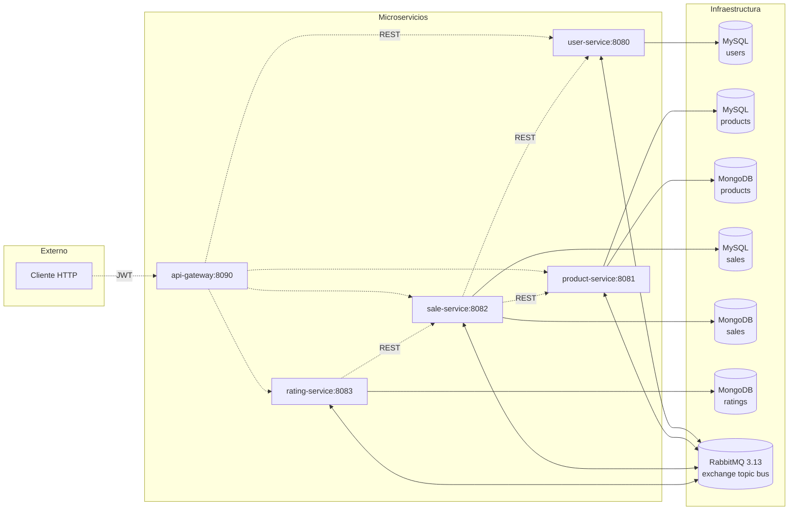

# Backend

Este documento describe sobre qué plataformas y con qué frameworks está construido el backend de SegundUM, los principios de diseño y arquitectura aplicados, cómo se comunican los microservicios, cómo se integra la API Gateway y cómo funcionan la documentación OpenAPI y la autenticación JWT.

## Plataformas y frameworks

El backend de SegundUM sigue una **arquitectura políglota**: la mayoría de microservicios (`user-service`, `product-service`, `sale-service`, `api-gateway`) están en Java, salvo `rating-service` en .NET, demostrando que los microservicios pueden mezclar plataformas y comunicarse igualmente por REST y un bus de eventos.

| Microservicio | Plataforma | Framework y/o tecnología | Puerto |
| --- | --- | --- | --- |
| `api-gateway` | Java 11 | Spring Boot 2.2.10.RELEASE + Netflix Zuul | 8090 |
| `user-service` | Java 11 | JAX-RS (Jersey 2.41) sobre Jetty (WAR) | 8080 |
| `product-service` | Java 11 | Spring Boot 2.6.1 | 8081 |
| `sale-service` | Java 11 | Spring Boot 2.6.1 | 8082 |
| `rating-service` | .NET 8.0 | ASP.NET Core | 8083 |

Tecnologías transversales:

- **Persistencia:** MySQL 8 y MongoDB 8.
- **Mensajería:** RabbitMQ 3.13.
- **Seguridad:** JWT (HS256) y hash de contraseñas con BCrypt.
- **Clientes HTTP internos:** Retrofit (Java) y Refit (.NET).
- **Documentación de la API:** OpenAPI con Swagger UI.
- **Despliegue:** Docker Compose (build desde código fuente).

## Microservicios

El sistema está descompuesto en cinco microservicios, cada uno dueño de lo que persiste. El **API Gateway** es la única puerta de entrada: todo el tráfico externo pasa por él.

> [!NOTE]
> Ningún microservicio accede directamente a las bases de datos de otro. La información compartida llega por el bus de eventos o mediante llamadas REST.

| Microservicio | Responsabilidad |
| --- | --- |
| `api-gateway` | Enrutado de las peticiones, emisión y borrado del JWT (login/logout) y autorización |
| `user-service` | Registro, autenticación, perfiles, roles (`USER` / `ADMINISTRATOR`), estadísticas y valoraciones recibidas |
| `product-service` | Catálogo: categorías (cargadas desde XML en el arranque), productos con su ciclo de vida, búsqueda paginada, vistas, histórico mensual y réplica de vendedores |
| `sale-service` | Ciclo de vida de las ventas (máquina de estados) y consulta de las partes implicadas |
| `rating-service` | Valoraciones entre las partes de una venta completada |

## Principios de diseño y arquitectura

SegundUM aplica varios principios de diseño y arquitectura, cada uno en los microservicios donde aporta:

| Principio | `user-service` | `product-service` | `sale-service` | `rating-service` | `api-gateway` |
| --- | :-: | :-: | :-: | :-: | :-: |
| Domain-Driven Design (diseño táctico) | Sí | Sí | Sí | No | No |
| Arquitectura hexagonal | Sí | Sí | Sí | Sí | Sí |
| Arquitectura limpia | Sí | Sí | Sí | No | Sí |
| CQRS | No | Sí | Sí | No | No |
| Event sourcing | No | No | Sí | No | No |

### Domain-Driven Design

El enfoque DDD modela el dominio con un lenguaje cercano al negocio y lo aborda en dos frentes: el **diseño estratégico**, que delimita dónde vive cada modelo, y el **diseño táctico**, que enriquece cada modelo por dentro.

#### Diseño estratégico

**Contextos acotados.** El sistema consta de 4 contextos, cada uno en su propio microservicio siendo dueño exclusivo de su modelo y de sus datos:

| Contexto | Microservicio | Modelo que posee | Frontera |
| --- | --- | --- | --- |
| **Usuarios** | `user-service` | Credenciales, perfiles, roles, estados y estadísticas | No conoce productos ni ventas |
| **Productos** | `product-service` | Productos, categorías, vendedores y puntos de recogida | No tiene usuarios: solo la réplica del vendedor. No tiene ventas |
| **Ventas** | `sale-service` | Las ventas entre comprador y vendedor y su ciclo de vida | No tiene usuarios ni productos: congela los datos que necesita (título, precio, nombre del vendedor) |
| **Valoraciones** | `rating-service` | Las valoraciones entre las partes de una venta completada | No tiene ventas: solo su identificador y sus partes |

Ningún contexto consulta los datos de otro (cada uno tiene sus propias bases de datos). Lo que hace falta del contexto upstream no se referencia, se **copia al modelo propio**, de modo que un contexto nunca depende de la disponibilidad de otro en tiempo de ejecución.

**Lenguaje ubicuo.** Cada contexto habla su propio idioma, y los términos del negocio coinciden con los del código, la API y los estados del sistema. Cada glosario recoge primero las acciones que el contexto permite y después los términos que nombra. Algunos términos se repiten entre contextos con un significado distinto (*vendedor, comprador, venta, producto*) y en cada tabla aparecen con el sentido de ese contexto.

**Contexto Usuarios**

| Término | Significado |
| --- | --- |
| *registrarse* | Darse de alta con correo, contraseña y datos personales |
| *autenticarse* | Validar correo y contraseña para usar el sistema |
| *desactivarse* | La cuenta pasa a inactiva y deja de poder usarse |
| **vendedor** | El rol con el que se acumulan sus estadísticas de ventas |
| **comprador** | El rol con el que se acumulan sus estadísticas de compras |

**Contexto Productos**

| Término | Significado |
| --- | --- |
| *publicar* | Poner un borrador a la venta (`FOR_SALE`) |
| *retirar* | Quitar de la venta un producto publicado. Vuelve a borrador |
| *descartar* | Desechar un borrador que no se va a publicar (`DELETED`) |
| *eliminar* | Retirar definitivamente un producto en venta (`DELETED`) |
| **borrador** | Producto creado que aún no está a la venta (`DRAFT`) |
| **vendedor** | Réplica del usuario que publica productos en el catálogo |
| **venta** | El estado de comercialización del propio producto (`DRAFT`, `FOR_SALE`…) |
| **producto** | La entidad completa (título, precio, categoría, vendedor, punto de recogida) |

**Contexto Ventas**

| Término | Significado |
| --- | --- |
| *proponer una venta* | El comprador propone que el vendedor le venda su producto. La venta queda pendiente (`PENDING`) |
| *reservar* | El vendedor acepta la propuesta (`RESERVED`) |
| *rechazar* | El vendedor no acepta la propuesta (`REJECTED`) |
| *completar* | La venta se cierra tras la entrega (`COMPLETED`) |
| *cancelar* | Cualquiera de las partes da por terminada una venta reservada |
| **venta** | El acuerdo entre comprador y vendedor y su ciclo de vida |
| **comprador** | La parte que adquiere el producto |
| **vendedor** | La parte que vende de esa venta concreta (sus datos quedan congelados en la venta) |
| **producto** | Solo su identificador y los datos que la venta congela |

**Contexto Valoraciones**

| Término | Significado |
| --- | --- |
| *valorar al vendedor* | Puntuar al vendedor de una venta completada |
| *valorar al comprador* | Puntuar al comprador de una venta completada |

#### Diseño táctico

La capa de dominio aplica el arsenal táctico del DDD: **value objects** con validación propia, **entidades y agregados** con invariantes, **factorías** que garantizan objetos válidos, **eventos de dominio** y **excepciones de dominio** expresivas.

**Aplicado en:** `user-service`, `product-service` y `sale-service`.

- **`user-service`** (contexto Usuarios): los value objects (correo, nombre, apellidos, contraseña, teléfono y fechas) se autovalidan al crearse: un correo sin formato válido o una contraseña demasiado corta no pueden llegar a existir. El usuario es una entidad con su rol (`USER` / `ADMINISTRATOR`) y su estado (activo o inactivo), con comprobaciones internas para que ninguna operación se aplique a un usuario desactivado. La factoría de usuarios es la única vía de creación, tanto en el registro como en la reconstrucción. Cada cambio relevante (registro, actualización y desactivación) tiene su evento de dominio, que **el caso de uso compone a partir del estado ya mutado del agregado y publica tras persistirlo**. Los errores de negocio se expresan con excepciones de dominio autoexplicativas ("la contraseña es demasiado corta", "el correo ya está registrado").
- **`product-service`** (contexto Productos): value objects para precio, título, descripción, identificadores y fechas. Entidades producto, categoría, vendedor y punto de recogida, cada una con su factoría. El producto tiene su máquina de estados (borrador, en venta, reservado, vendido, eliminado) protegida por invariantes que impiden transiciones ilegales (solo se puede publicar un borrador, y solo un producto en venta puede reservarse). Su ciclo de vida se refleja en eventos de dominio que **los casos de uso construyen tras la mutación de estado del agregado y publican tras persistir**. Los errores como "el precio no puede ser negativo" se señalan con excepciones de dominio. Una excepción es que el evento `CategoryCreated` se publica desde un adaptador de infraestructura (el cargador de jerarquía de categorías en XML) en lugar de desde un caso de uso.
- **`sale-service`** (contexto Ventas): el agregado venta reúne las dos partes (comprador y vendedor), el producto y la máquina de estados (propuesta, reservada, rechazada, cancelada, completada), con invariantes como "solo una venta pendiente puede reservarse", "el comprador no puede ser su propio vendedor" o "solo se puede valorar una venta completada". Su factoría tiene dos vías: el alta de una venta nueva y la reconstrucción desde su historial de eventos (la base del event sourcing, más abajo). **El propio agregado registra cada transición como evento** (`apply()`/`when()` acumula el evento pendiente en `uncommittedEvents`, y el caso de uso drena esa lista para guardarlo en el almacén de eventos y publicarlo en el bus), como exige el event sourcing, y las reglas incumplidas se expresan con excepciones de dominio.

Ideas transversales: el dominio se autovalida con sus propias excepciones (no con errores de framework) y las factorías son la única puerta de creación de objetos.

> **Nota sobre la gestión de los eventos de dominio.** La forma en que nace un evento difiere entre servicios de forma deliberada, porque responde al patrón de persistencia de cada uno, no a una deuda:
>
> - En `sale-service`, los eventos son la fuente de verdad, así que **el agregado `Sale` gestiona sus eventos**: cada operación aplica el evento sobre su estado y lo deja pendiente. El caso de uso solo lo drena para persistirlo en el almacén de eventos y publicarlo.
> - En `user-service` y `product-service`, los agregados persisten su estado (JPA) y **no gestionan eventos**: los eventos son hechos ya consumados que el caso de uso compone desde el estado del agregado y publica tras guardar.
>
> En los tres servicios, el dominio decide **qué transiciones son válidas** (sus invariantes). Lo que varía es **quién materializa ese hecho como evento**: el agregado en `sale-service`, el caso de uso en `user-service` y `product-service`.

### Arquitectura hexagonal

La arquitectura hexagonal (puertos y adaptadores) define el núcleo de la aplicación mediante interfaces llamadas **puertos**: los de **entrada**, por los que llegan las peticiones, y los de **salida**, por los que el núcleo toca el exterior. Los **adaptadores** son las implementaciones concretas de cada puerto. Viven en el borde y contienen la tecnología, de modo que se puede cambiar de tecnología sin tocar el núcleo.

**Aplicado en:** `user-service`, `product-service`, `sale-service`, `rating-service` y `api-gateway` (versión fina: un único caso de uso con su puerto de salida y adaptador).

Lado entrante:

| Necesidad del núcleo (puerto de entrada) | Adaptador de entrada | Tecnología | Microservicios |
| --- | --- | --- | --- |
| Recibir peticiones HTTP | Controlador REST (puntos de entrada HTTP en .NET) | JAX-RS (Jersey), Spring MVC, .NET Minimal APIs | `user-service`, `product-service`, `sale-service`, `rating-service`, `api-gateway` |
| Recibir eventos del bus | Consumidor de colas | RabbitMQ | `user-service`, `product-service` |
| Testear los casos de uso | La propia prueba unitaria | JUnit 5, xUnit | `user-service`, `product-service`, `sale-service`, `rating-service`, `api-gateway` |

Lado saliente:

| Necesidad del núcleo (puerto de salida) | Adaptador | Tecnología | Microservicios |
| --- | --- | --- | --- |
| Guardar los datos mediante modelos de escritura | Repositorio de escritura | MySQL en `user-service`, `product-service`y `sale-service`. MongoDB en `rating-service` | `user-service`, `product-service`, `sale-service`, `rating-service` |
| Consultar los modelos de lectura | Repositorios de consulta | MySQL en `user-service`. MongoDB en `product-service`, `sale-service` y `rating-service` | `user-service`, `product-service`, `sale-service`, `rating-service` |
| Publicar los eventos de dominio | Adaptador del bus de eventos | RabbitMQ | `user-service`, `product-service`, `sale-service`, `rating-service` |
| Consultar a otros servicios | Cliente HTTP interno | REST (Retrofit en Java, Refit en .NET) | `sale-service`, `rating-service`, `api-gateway` |
| Validar contraseñas | Hash con sal | BCrypt | `user-service` |
| Cargar la jerarquía de categorías | Lector de árboles XML | XML | `product-service` |
| Almacenar y recuperar los eventos de las ventas | Almacén de eventos | MySQL | `sale-service` |

### Arquitectura limpia

La arquitectura limpia organiza el código en capas concéntricas: las reglas de negocio viven en el interior y las decisiones técnicas en el exterior, de modo que **el interior nunca depende del exterior, sino al revés**. Este fundamento se conoce como la **Regla de la Dependencia**: las dependencias de cada capa solo pueden apuntar hacia dentro.

**Aplicado en:** `user-service`, `product-service`, `sale-service` y `api-gateway`.

Los tres servicios con capa de dominio se organizan en tres capas:

- **Dominio**: los modelos y las reglas de negocio junto con sus validaciones y sus excepciones propias. Esta capa no utiliza ningún framework: depende solo de la biblioteca estándar del lenguaje.
- **Aplicación**: la orquestación de cada operación del sistema, definida independientemente de cualquier tecnología concreta.
- **Infraestructura**: los detalles técnicos que se conectan con las capas interiores a través de interfaces.

### CQRS

CQRS (*Command Query Responsibility Segregation*) separa a nivel de casos de uso las **operaciones de escritura** (comandos, que aplican las reglas de negocio y guardan de forma transaccional) de las **operaciones de lectura** (consultas, optimizadas para devolver datos listos para la API). En SegundUM, los comandos se ejecutan sobre el modelo de escritura y, tras confirmarse, los eventos generados alimentan por asíncrono el modelo de lectura, que es el que responde a las consultas.

**Aplicado en:** `product-service` y `sale-service`.

- En `product-service`, las escrituras sobre categorías, vendedores y productos se hacen en MySQL y, después de confirmarse la transición, se ejecutan de forma asíncrona las proyecciones que actualizan los modelos de lectura.
- En `sale-service`, la escritura no guarda estado actual, sino los eventos de las ventas. Las consultas se resuelven sobre el modelo de lectura.

### Event Sourcing

La técnica de Event Sourcing consiste en guardar el estado de un agregado no como una fila con su valor actual, sino como una **secuencia inmutable de eventos de dominio**: se persisten los hechos ocurridos, y el agregado se reconstruye reproduciendo su historial. Cada comando se valida sobre ese estado derivado. Si la operación es válida, se genera un evento nuevo que se añade al historial.

**Aplicado en:** `sale-service`.

En `sale-service`, el agregado de venta gestiona sus propios eventos (ver la nota en *Diseño táctico*). Algunas características reflejadas son las siguientes:

- **No existe ninguna tabla con el estado actual de las ventas** ni un repositorio de ventas: la base de datos de escritura en el microservicio de las ventas solo contiene el historial de eventos.
- **Toda operación sobre una venta** (reservar, completar, rechazar, cancelar) comienza recuperando el historial y reconstruyendo el estado. Solo entonces valida las invariantes y registra el evento correspondiente.
- **Incluso algunas consultas de negocio** se responden reconstruyendo la venta desde sus eventos (por ejemplo, para saber si ya existe una propuesta abierta).
- **MongoDB es solo de lectura**: ninguna escritura del agregado pasa por la colección de ventas.

#### Tradeoffs de la implementación actual

La implementación prioriza la sencillez sobre la robustez, y de esa decisión consciente se derivan cuatro limitaciones conocidas, cada una con su respectivo problema operativo y posible mitigación futura:

| Limitación | Problema operativo | Mitigación futura |
| --- | --- | --- |
| **Sin *snapshots*** | Toda operación reconstruye el agregado entero reproduciendo todo su historial, de modo que el coste crece con el número de eventos acumulados. El impacto está acotado en este dominio, dado que cada venta no acumula más de unos pocos eventos en su ciclo de vida, pero un agregado de historial largo (o un volumen alto de reconstrucciones) notaría el coste. | Guardar periódicamente un *snapshot* del estado y reconstruir solo desde el último, en vez de desde el primer evento. |
| **Sin control de concurrencia** | Dos comandos simultáneos sobre la misma venta pueden reconstruir el mismo estado, validarlo y añadir sus eventos encima sin que nada lo detecte. El historial acabaría con dos transiciones saliendo del mismo estado (por ejemplo, una venta "reservada" y "rechazada" a la vez), algo que la máquina de estados prohíbe, y las proyecciones reflejarían un estado imposible. | Control de concurrencia optimista: añadir una columna de versión en el event store y comprobarla al insertar. Si otro evento ya se coló, rechazar la operación y reconstruir sobre el historial actualizado. |
| **Orden por *timestamp*, no por secuencia** | Los eventos se recuperan ordenados por su *timestamp* en lugar de por un número de secuencia inmutable por agregado. Con dos eventos concurrentes del mismo agregado en instantes casi idénticos, el orden de reconstrucción no está garantizado. | Asignar un número de secuencia correlativo por agregado al insertar y ordenar por él, en lugar de por la marca de tiempo. |
| **Esquemas de evento sin versionar** | El tipo guardado en cada fila es el nombre de la clase Java del evento y la carga útil es un mapa con las claves fijadas a mano en el mapeador, sin campo de versión ni *upcasters*. Renombrar una clase de evento o cambiar o eliminar una clave del payload rompe la reconstrucción de las ventas antiguas (una clave ausente se convierte en un valor nulo que dispara excepciones de dominio al reconstituir), y no hay migraciones que reescriban el histórico: el esquema de la base de datos queda de hecho ligado a los nombres de las clases del dominio. | Versionar cada tipo de evento y traducir los payloads antiguos al formato actual al cargar (*upcasters*). Como mínima, mantener alias de los tipos antiguos y permitir solo evolución aditativa (claves nuevas opcionales con valor por defecto). |

## Comunicación

Los microservicios se pueden comunicarse entre sí de dos formas: **síncrona** por REST, cuando necesitan una respuesta inmediata, y **asíncrona** por el bus de eventos, para difundir hechos sin acoplar emisor y receptores.

### Síncrona (REST)

Las llamadas REST tienen lugar dentro de la red de contenedores y son de dos tipos: las que hace el propio gateway para dar servicio al login y las que hacen entre sí los servicios para enriquecer sus respuestas sin salir de la red.

- **`api-gateway`** usa **Retrofit** para validar las credenciales del login contra `user-service` (`POST /api/users/authenticate`). Sobre el usuario devuelto se construye después el JWT.
- **`sale-service`** usa **Retrofit** para leer el nombre de un usuario (`GET /api/users/{id}/name`) y la información básica de un producto (`GET /api/products/{id}/basic-info`).
- **`rating-service`** usa **Refit** para leer las partes de una venta (`GET /api/sales/{id}/parties`), de las que obtiene comprador y vendedor.

Por eso esos endpoints internos están **bloqueados externamente** en el gateway: no pueden invocarse desde fuera.

### Asíncrona (RabbitMQ)

Todos los servicios publican eventos de dominio en un **exchange de tipo `topic` llamado `bus`**, con routing keys de la forma `bus.<servicio>.<TipoEvento>`, donde el segmento del servicio va en **plural** (`users`, `products`, `sales`, `ratings`). Dos colas consumen esos eventos:

| Cola | Servicio consumidor | Binding keys | Eventos que recibe |
| --- | --- | --- | --- |
| `users` | `user-service` | `bus.sales.#`, `bus.ratings.#` | Todos los eventos de ventas y de valoraciones |
| `products` | `product-service` | `bus.users.#`, `bus.sales.#` | Todos los eventos de usuarios y de ventas |

`sale-service` y `rating-service` solo publican: no declaran colas propias.

#### Publicados por user-service (`bus.users.*`)

| Routing key | Receptor | Efecto |
| --- | --- | --- |
| `bus.users.UserRegistered` | `product-service` | Crea la réplica del vendedor en MongoDB |
| `bus.users.UserUpdated` | `product-service` | Actualiza la réplica del vendedor |
| `bus.users.UserDeactivated` | `product-service` | Desactiva la réplica del vendedor |

#### Publicados por product-service (`bus.products.*`)

Eventos que se publican en el bus:

- `bus.products.ProductCreated`
- `bus.products.ProductUpdated`
- `bus.products.ProductPutOnSale`
- `bus.products.ProductTakenDown`
- `bus.products.ProductReserved`
- `bus.products.ProductSold`
- `bus.products.ProductReservationCancelled`
- `bus.products.ProductRemoved`
- `bus.products.ProductDiscarded`
- `bus.products.ProductViewsIncremented`
- `bus.products.PickupLocationAssigned`

> Actualmente ninguna cola está vinculada a `bus.products.#`: estos eventos se publican en el bus por si se incorporan consumidores en el futuro.

#### Publicados por sale-service (`bus.sales.*`)

| Routing key | Receptor | Efecto |
| --- | --- | --- |
| `bus.sales.SaleProposed` | - | Llega a ambas colas, sin tratamiento específico hoy |
| `bus.sales.SaleReserved` | `product-service` | El producto pasa de `FOR_SALE` a `RESERVED` |
| `bus.sales.SaleCompleted` | `product-service` | El producto pasa a `SOLD` |
| `bus.sales.SaleCompleted` | `user-service` | Incrementa los contadores de compras/ventas del usuario |
| `bus.sales.SaleRejected` | - | Llega a ambas colas, sin tratamiento específico hoy |
| `bus.sales.SaleCancelledByPurchaser` | `product-service` | El producto vuelve de `RESERVED` a `FOR_SALE` |
| `bus.sales.SaleCancelledBySeller` | `product-service` | El producto vuelve de `RESERVED` a `FOR_SALE` |

#### Publicados por rating-service (`bus.ratings.*`)

| Routing key | Receptor | Efecto |
| --- | --- | --- |
| `bus.ratings.RatingCreated` | `user-service` | Registra la valoración (contador de valoraciones como comprador/vendedor y media del usuario) |

#### Tradeoffs asumidos

Los eventos se publican en cuanto el caso de uso los compone, sin esperar confirmación de ningún receptor, y no hay ninguna coordinación entre servicios más allá del propio bus. De ahí se derivan tres limitaciones conocidas:

| Limitación | Problema operativo | Mitigación futura |
| --- | --- | --- |
| **Sin *outbox*** | Guardar el estado y avisar al resto del sistema son dos operaciones sobre dos sistemas distintos, y ninguna puede confirmar a la otra. Si el bus acepta el aviso y después falla el guardado, el resto del sistema reacciona a un suceso que nunca llegó a producirse. Si en cambio el guardado sale bien y el aviso no llega, el resto se queda para siempre sin enterarse, y además nadie lo nota porque la operación devuelve éxito. Qué riesgo predomina depende del orden que se siga: en unos casos el aviso sale antes de asegurar el estado y predomina el de reaccionar a sucesos inexistentes, y en otros se asegura primero y el aviso se intenta después sin comprobar si tuvo éxito y predomina el de perderse un suceso real. Tampoco hay una reacción común ante un bus caído: en unos casos la operación se aborta entera, y en otros se da por buena y solo queda constancia en el registro. | Guardar el aviso dentro de la misma transacción que el estado, en una tabla que otro proceso se encargue de enviar una vez confirmada la transacción (el *outbox*). Así los dos efectos quedan unidos: o se guardan los dos o no se guarda ninguno, y el envío, aunque pueda retrasarse, no puede ni perderse ni inventarse. La parte más costosa de este diseño ya está hecha, porque el registro de sucesos de la venta se escribe dentro de esa misma transacción, así que solo faltarían la marca de lo que ya se ha enviado y el proceso que vaya enviándolo. |
| **Sin *saga*** | Las operaciones que cruzan de un servicio a otro se lanzan sin esperar nada: quien envía el aviso sigue sin comprobar si el otro lado pudo aplicarlo, y como además no escucha nada, no tiene forma de enterarse de un fracaso. Si el receptor no puede aplicar el aviso, lo desecha sin más dejando constancia en el registro, con lo que el mensaje se pierde sin que nadie reaccione. El resultado es que el sistema queda desincronizado de forma permanente con una única línea de registro como rastro. Por ejemplo, una venta puede quedar reservada mientras el producto correspondiente sigue disponible, sin que ninguna de las dos partes lo note ni exista nada que lo arregle. Tampoco hay avisos de deshacer: los que circulan describen pasos normales del negocio, no su reverso. Lo único que amortigua el problema es que los mensajes quedan guardados en el bus, así que si el receptor no está disponible esperan. Lo que no tiene arreglo es que se reciban y se desechen. | Coordinar esas operaciones con una *saga*: que exista un responsable de la operación completa que conozca sus pasos y que pueda pedir a cada parte que deshaga lo que ya hizo cuando uno intermedio falla. Ese responsable puede dar las órdenes desde un sitio (orquestación), o pueden ser los propios servicios avisándose entre sí con mensajes de fallo y alguien escuchándolos (coreografía). |
| **Sin garantías de entrega** | Nada garantiza que un mensaje llegue ni que se aplique una sola vez. Quien envía no espera ninguna confirmación de que el bus lo haya recibido, no reintenta si falla, y no existe ningún sitio al que vayan a parar los mensajes que nadie pueda tratar, ni la posibilidad de devolverlos para que vuelvan. Del lado contrario, quien recibe no deja escapar ningún error: da el mensaje por recibido siempre, incluso cuando no ha podido aplicarlo, de modo que una vez tratado desaparece para siempre y solo el registro permite saber que algo falló. Tampoco hay protección contra duplicados, así que cualquier reintento futuro chocaría con lo ya aplicado. Hoy eso pasa inadvertido únicamente porque los mensajes nunca se reenvían. | Activar las confirmaciones de que el bus ha recibido cada mensaje y montar una política de reintentos con una cola aparte donde acaben los mensajes que sigan fallando tras agotar los intentos (una *DLQ*). Ambas medidas introducen reenvíos, así que antes que nada habría que hacer que cada receptor pudiera reconocer y descartar un mensaje que ya hubiera procesado. |

#### Panel de gestión

En modo desarrollo, el panel de gestión de RabbitMQ está disponible en http://localhost:15672 (credenciales de `.env`). Desde ahí se pueden ver el exchange `bus`, las colas `users` y `products`, sus vinculaciones y el número de mensajes publicados y consumidos.

## API Gateway

El `api-gateway` (Spring Boot + Netflix Zuul) es la **única puerta de entrada** del sistema. Expone su API bajo `/api` en el puerto 8090 y enruta internamente a cada servicio:

| Ruta externa | Servicio |
| --- | --- |
| `/api/users/**` | `user-service` |
| `/api/products/**` | `product-service` |
| `/api/categories/**` | `product-service` |
| `/api/sellers/**` | `product-service` |
| `/api/sales/**` | `sale-service` |
| `/api/ratings/**` | `rating-service` |

Además del enrutado, el gateway concentra la política de autenticación y autorización:

- **Públicos:** registro (`POST /api/users`), login/logout (`/api/auth/**`), búsqueda de productos, detalle de producto, incremento de vistas, histórico mensual, productos en venta de un vendedor, categorías y Swagger (solo desarrollo).
- **Bloqueados:** los endpoints internos (`POST /api/users/authenticate`, `GET /api/users/{id}/name`, `GET /api/products/{id}/basic-info` y `GET /api/sales/{id}/parties`). No pueden invocarse desde el exterior. La autenticación real se hace con `POST /api/auth/login` y el resto de llamadas internas entre servicios ocurren dentro de la red de contenedores.
- **Resto:** requieren un JWT autenticado (p. ej. crear productos exige el rol `USER` y que el `sellerId` coincida con el usuario autenticado).

## OpenAPI

Todos los servicios exponen su especificación **OpenAPI** con **Swagger UI** en `/api/swagger-ui` cuando arrancan en modo desarrollo. Esto permite explorar y probar toda la API de forma interactiva sin necesidad de herramientas externas.

## JWT

La autenticación se basa en **JSON Web Tokens** firmados con el algoritmo **HS256**:

- **Emisión:** `POST /api/auth/login` en el gateway valida email y contraseña (validación vía `user-service`) y devuelve un token firmado con el secreto compartido `JWT_SECRET` (caducidad de 1 hora), tanto en el cuerpo de la respuesta (`{"token": ..., "userId": ..., "fullName": ..., "roles": [...]}`) como en una cookie `httpOnly` `access_token`. `POST /api/auth/logout` borra la cookie.
- **Transporte:** los clientes envían el token en la cabecera `Authorization: Bearer <token>` o en la cookie `access_token`. Ambas formas se aceptan en todos los servicios.
- **Validación:** el gateway valida el token y lo reenvía. Cada servicio vuelve a validarlo con el mismo secreto compartido, de forma que ningún servicio confía a ciegas en el gateway.
- **Roles:** `USER` y `ADMINISTRATOR`, más el estado del usuario (`ACTIVE` / `INACTIVE`). Cada endpoint define qué exige.
