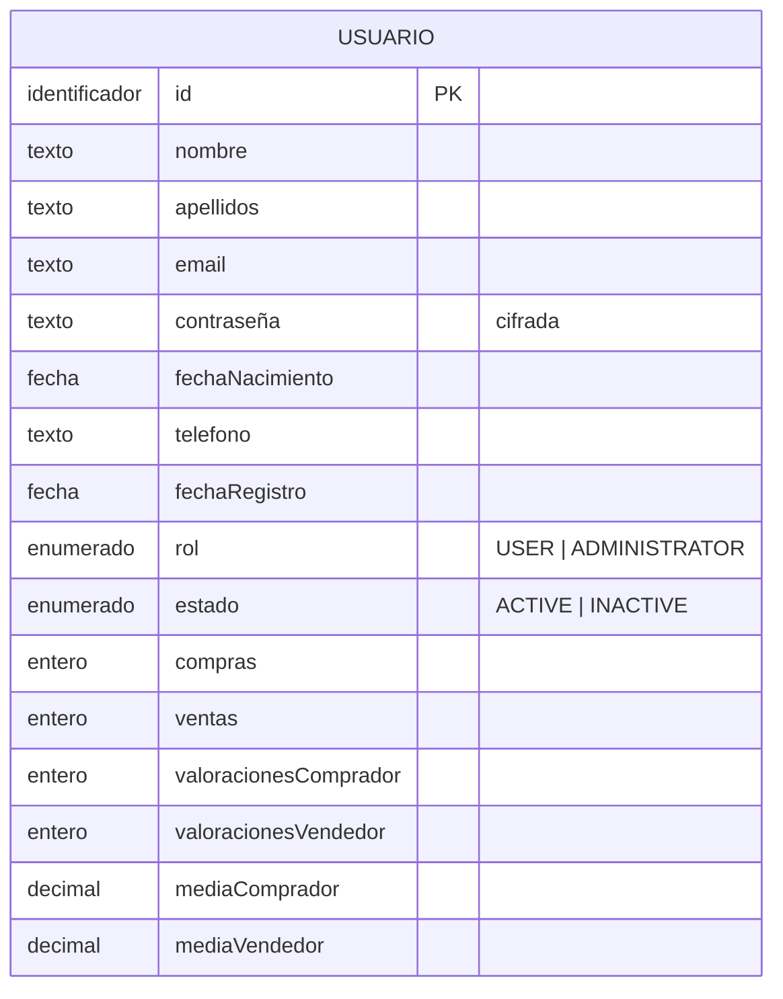
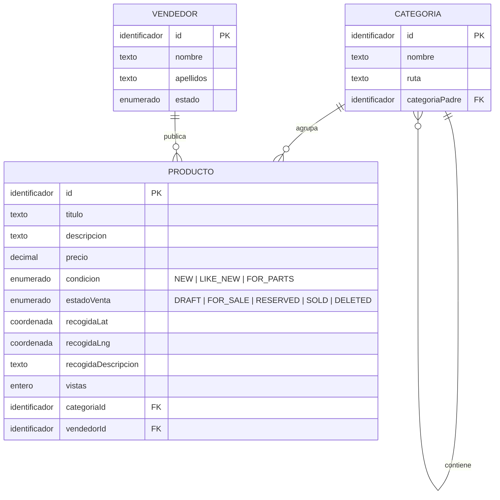
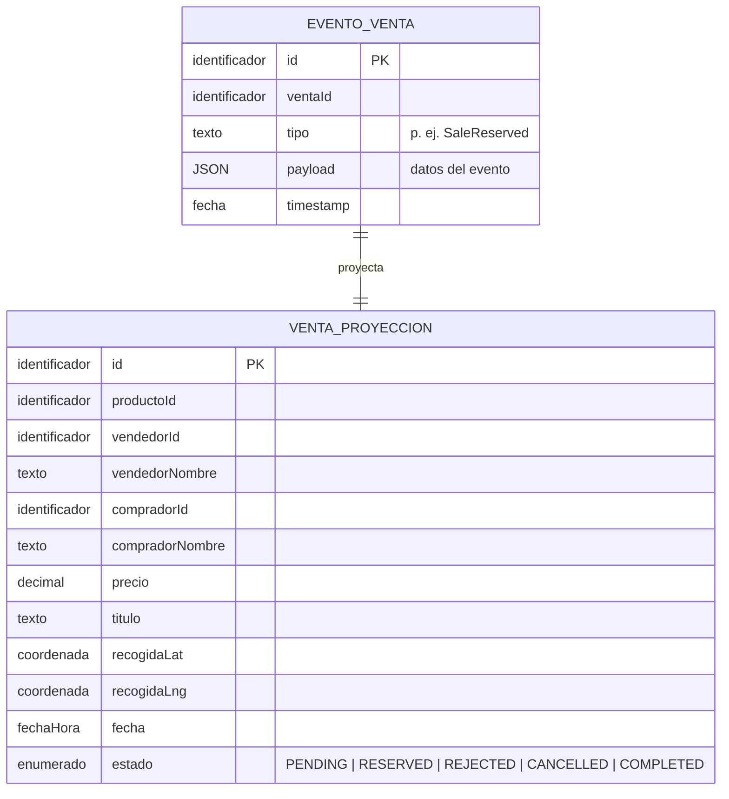
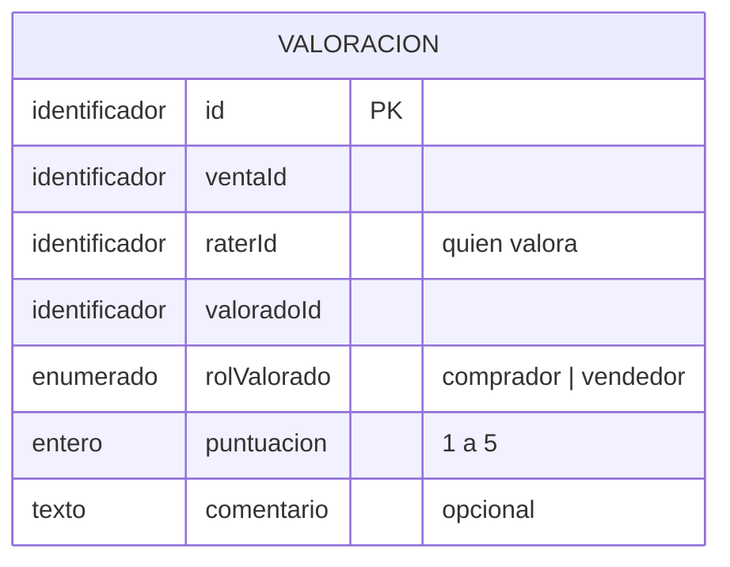

# Datos

Este documento describe la perspectiva de los datos en SegundUM: qué entidades y relaciones persiste cada servicio, qué consultas necesita la API (patrones de acceso), cuál es el esquema conceptual y por qué se ha elegido cada tecnología de persistencia.

## Perspectiva de los datos

Cada servicio es dueño de sus datos (*base de datos por servicio*): persiste lo que necesita para cumplir su responsabilidad y no accede a las bases de otros servicios. La información que necesita un servicio de otro llega por el bus de eventos o mediante llamadas REST.

### user-service

**Entidades a persistir (MySQL):**

- **Usuario**: perfil (nombre, apellidos, email, contraseña cifrada, teléfono, fecha de nacimiento, fecha de registro), rol (`USER` / `ADMINISTRATOR`), estado (`ACTIVE` / `INACTIVE`), estadísticas (compras y ventas realizadas) e información acerca de su reputación (número de valoraciones recibidas como comprador y como vendedor, con su media en cada caso).

**Patrones de acceso:**

| Consulta | Contexto |
| --- | --- |
| Buscar usuario por email (y validar contraseña) | Login |
| Obtener el perfil del usuario | Perfil |
| Listar todos los usuarios | Administración |
| Obtener estadísticas | Perfil |
| Obtener las valoraciones recibidas | Perfil |
| Actualizar perfil / desactivar usuario | Comandos  |
| Obtener nombre completo de un usuario | Interno (lo usa `sale-service`) |

### product-service

**Entidades a persistir (MySQL, modelo de escritura):**

- **Categoría**: jerarquía precargada desde ficheros XML en el arranque (nombre y ruta dentro del árbol).
- **Vendedor**: réplica de los usuarios vendedores, sincronizada con los eventos de `user-service`.
- **Producto**: título, descripción, precio, condición (`NEW` / `LIKE_NEW` / `FOR_PARTS`), estado de venta (`DRAFT` / `FOR_SALE` / `RESERVED` / `SOLD` / `DELETED`), punto de recogida (coordenadas y descripción), vistas, y sus relaciones con categoría y vendedor.

**Modelos de lectura (MongoDB):** réplicas consultables de productos, categorías y vendedores, alimentadas por proyecciones.

**Patrones de acceso:**

| Consulta | Contexto |
| --- | --- |
| Búsqueda paginada de productos con filtros (categoría, descripción, condición, precio máximo) | Catálogo público |
| Detalle completo de un producto | Ficha pública |
| Categorías de primer nivel y subcategorías de una categoría | Navegación del catálogo |
| Productos en borrador de un vendedor | Panel del vendedor |
| Productos en venta de un vendedor | Navegación pública adicional, y panel del vendedor |
| Histórico mensual de productos (por vistas) | Estadísticas públicas |
| Incrementar el contador de vistas | Ficha pública |
| Obtener información básica de un producto | Interno (lo usa `sale-service`) |

### sale-service

**Entidades a persistir (MySQL, modelo de escritura):**

- **Evento de venta** (almacén de eventos): cada evento registrado sobre una venta se guarda como un registro inmutable con su identificador, la venta a la que pertenece, el tipo de evento, el payload y su timestamp. Es el único contenido de la base de datos de escritura: no hay ninguna tabla con el estado actual de la venta.

Conceptualmente, la venta reconstruida a partir de su historial contiene: producto, vendedor (identificador y nombre completo), comprador (identificador y nombre completo), precio, título, punto de recogida, fecha y hora, y estado (`PENDING` / `RESERVED` / `REJECTED` / `CANCELLED` / `COMPLETED`).

**Modelos de lectura (MongoDB):** las ventas publicadas, reconstruidas para su consulta.

**Patrones de acceso:**

| Consulta | Contexto |
| --- | --- |
| Reconstruir la venta desde su historial de eventos | Toda operación (reservar, completar, rechazar, cancelar) |
| Comprobar si ya existe una propuesta abierta del producto | Propuesta de venta |
| Búsqueda paginada con filtros (comprador, vendedor, estado) | Administración |
| Ventas del comprador / del vendedor (filtro opcional por estado) | Paneles de usuario |
| Obtener comprador y vendedor de una venta | Interno (lo usa `rating-service`) |

### rating-service

**Entidades a persistir (MongoDB):**

- **Valoración**: la venta de la que nace, quién valora, a quién se valora, el rol del valorado en esa venta (comprador o vendedor), la puntuación (de 1 a 5) y un comentario opcional.

**Patrones de acceso:**

| Consulta | Contexto |
| --- | --- |
| Registrar una valoración (única por venta y por parte valorada) | POST del cliente |
| Obtener una valoración por su identificador | Consulta puntual |
| Valoraciones recibidas como vendedor / como comprador | Perfil de usuario |

## Esquema conceptual

Cada servicio modela su propio esqueleto de datos. No hay relaciones físicas entre bases de datos de servicios distintos (las conexiones conceptuales se cubren con eventos y llamadas REST). Los esquemas recogen los conceptos que cada servicio modela. Los modelos de lectura de MongoDB son copias proyectadas de esos mismos conceptos y no se representan aparte. La única excepción es `sale-service`, donde la venta sí aparece proyectada porque, sin estado propio en el almacén de eventos, la venta solo existe como reconstrucción de su historial.

### user-service (MySQL)

### product-service (MySQL de escritura + MongoDB de lectura)

### sale-service (MySQL de eventos + MongoDB de lectura)

### rating-service (MongoDB)

## Elección de la arquitectura de datos

SegundUM sigue el enfoque de **persistencia políglota**: en vez de imponer una única base de datos a todo el sistema, cada servicio elige la tecnología que mejor encaja con su modelo. Conviven dos motores (MySQL relacional, y MongoDB documental) y su uso varía por servicio: `user-service` persiste solo en MySQL, `rating-service` solo en MongoDB, y `product-service` y `sale-service` combinan ambos porque, en ellos, la separación entre modelo de escritura y modelo de lectura (CQRS) y el almacenamiento de los eventos (Event Sourcing) divide también el motor de escritura (MySQL) del de lectura (MongoDB). Estas decisiones tienen las siguientes consecuencias en la persistencia:

- **MySQL para los modelos de escritura.** Los datos transaccionales (usuarios, categorías, vendedores y productos) requieren integridad y atomicidad: las operaciones de negocio son transacciones relacionales clásicas (p. ej. crear un producto con su categoría y vendedor), para las que MySQL y JPA encajan de forma natural. El almacén de eventos de las ventas también vive en MySQL, donde cada evento se inserta como una fila inmutable más.
- **MongoDB para los modelos de lectura.** Las consultas de lectura (búsqueda paginada con filtros, listados por vendedor o comprador, valoraciones recibidas) se resuelven sobre documentos denormalizados y listos para la API, sin joins ni gravar el modelo transaccional. MongoDB aporta flexibilidad de esquema, ya que las proyecciones no tienen por qué reflejar el modelo relacional.
- **Sincronización mediante proyecciones.** El modelo de lectura se mantiene al día con proyecciones que se ejecutan de forma asíncrona tras confirmarse cada escritura (en `product-service`) o al consumir los eventos del bus (en `sale-service`). La réplica de vendedores y las estadísticas de los usuarios son también proyecciones de eventos: los eventos publicados en el bus actualizan los almacenes de lectura sin acoplar servicios.
- **Event store como fuente de verdad de las ventas.** En `sale-service` no se guarda el estado actual: el historial de eventos es la única fuente de verdad, de modo que el estado de cualquier venta en cualquier momento se puede reconstruir y las proyecciones de lectura se pueden regenerar desde cero. La implementación actual no usa *snapshots*, ni control de concurrencia optimista, ni un formato de evento versionado.
- **Una base de datos por servicio.** Cada servicio elige y evoluciona sus almacenes sin afectar a los demás, y ningún servicio consulta directamente la base de otro (la información compartida se replica por eventos). En el despliegue con Docker Compose, esas bases de datos lógicas se alojan en un único contenedor MySQL y un único MongoDB por simplicidad.
- **XML como carga inicial.** La jerarquía de categorías no se introduce por la API: se carga en el arranque de `product-service` desde ficheros XML incluidos en el repositorio.
